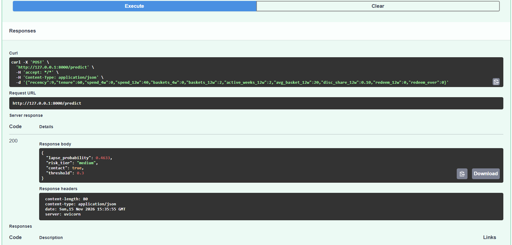

# Household Lapse Risk with Coupon Targeting

ML Zoomcamp 2026 midterm project. A model that predicts which grocery households will stop shopping in the next 4 weeks, so a retailer can decide whom to contact with a retention offer.

## Problem

A retailer wants to spot households that are drifting away before they are gone. For every household at the end of any week, the model estimates the probability that it makes **no purchase in the following 4 weeks** ("lapse"). The service returns that probability, a risk tier and a yes/no contact decision. The retailer can use it to rank households for a retention campaign when the budget covers only some of them.

The model predicts who is likely to lapse, not who would respond to a coupon. Measuring that would need a randomized experiment.

## Data

dunnhumby **The Complete Journey**: grocery transactions of 2,500 households over 102 weeks (2,595,732 product lines), plus coupon, campaign and demographic tables.
Source: https://www.dunnhumby.com/source-files/
License/terms: see the dunnhumby download page (https://www.dunnhumby.com/source-files/). The data is not redistributed in this repository.
The raw data is **not** in this repository. To reproduce, download it and put the 8 CSV files in `data/raw/`.

## Approach

**Prediction unit.** One row per household and cut-off week (weeks 12 to 98), 214,284 rows. Features use only weeks up to the cut-off, and the label looks at the next 4 weeks. Lapse rate: 20.1%.

**Leakage control.** I recomputed every feature and the label from the raw transactions for 300 random rows (0 mismatches).

**Time-based split with 4-week gaps** (labels look 4 weeks ahead, so a random split would leak):

| Block | Cut-off weeks | Rows | Lapse rate |
|---|---|---|---|
| Train | 12-66 | 134,335 | 0.206 |
| Validation | 71-82 | 29,976 | 0.196 |
| Test | 87-98 | 29,989 | 0.194 |

**Metric.** About 20% of rows are positive, so accuracy is misleading. The main metric is PR-AUC (a model with no skill scores about 0.20), with ROC-AUC, Brier score, and precision/recall at a chosen threshold.

## EDA findings

- The lapse rate is stable over time (17.9% to 22.3% by cut-off week).
- Recency is a strong signal: 5.8% lapse if the household bought this week, 71.5% after 9 or more weeks of silence.
- Shopping frequency is strongly protective: 0.9% lapse with 33+ trips in 12 weeks, 75.6% with none.
- Tenure barely matters (19% to 21%). It only measures time since the first purchase we can observe in a two-year window.
- Spend and trip counts are heavily right-skewed, so they are log-transformed for Logistic Regression.

## Models

Logistic Regression, Decision Tree, Random Forest and XGBoost were trained on three feature sets, then Logistic Regression, Random Forest and XGBoost were tuned with random search on the validation block.

| Model (tuned, behavior features), validation block | PR-AUC | ROC-AUC | Brier |
|---|---|---|---|
| Recency alone (baseline) | 0.573 | | |
| Decision Tree (not tuned) | 0.622 | 0.881 | n/a |
| Logistic Regression | 0.639 | 0.885 | 0.1031 |
| Random Forest | 0.642 | 0.887 | 0.1022 |
| **XGBoost (selected)** | **0.642** | 0.887 | 0.1031 |

The three models are within 0.004 PR-AUC, which is a tie on this data. XGBoost was selected for the best PR-AUC, speed and small model file. Logistic Regression is a simpler, more explainable alternative.

**Feature-set ablation** (untuned models, validation PR-AUC):

| Features | Forest | LogReg |
|---|---|---|
| Behavior + discount/coupon (set B) | 0.639 | 0.639 |
| + campaigns | 0.640 | 0.641 |
| + `has_demo` flag only | 0.644 | 0.645 |
| + demographic categories | 0.646 | 0.645 |
| Everything | 0.645 | 0.646 |

The small gain from demographics comes almost entirely from whether a household has a profile on file, not from what is in it. That flag is not about shopping behavior, so the final model uses behavior features only (set B, 11 features), at a cost of about 0.005 PR-AUC.

## Feature importance

Permutation importance on the validation block (drop in PR-AUC when shuffled):

| Feature group | Drop |
|---|---|
| Frequency (`baskets_4w`, `baskets_12w`, `active_weeks_12w`) | 0.278 |
| Recency | 0.054 |
| Spend | 0.005 |
| Tenure | 0.002 |
| Discount and coupon | 0.0004 |

Frequency features are correlated, so single-feature importance understates them; the group test accounts for that. The model is mainly "how often and how recently does this household shop"; coupon behavior added no measurable signal.

## Final test results

Evaluated once on the untouched last 12 cut-off weeks, with the model and threshold frozen beforehand:
 
| Metric | Value |
|---|---|
| PR-AUC | 0.622 (recency alone: 0.554, no skill: 0.194) |
| ROC-AUC | 0.882 |
| Brier score | 0.1048 (constant prediction: 0.1567) |
| At threshold 0.30 | contacts 23.8% of households, precision 0.561, recall 0.687 |
| Lift, riskiest 10% | 3.6x the average lapse rate |

Compared with the simple rule "recency of 3 weeks or more" at a similar contact volume (precision 0.523, recall 0.635), the model finds more lapsers with fewer false alarms. The gain is mainly for households that are slipping but not yet long gone.

The threshold 0.30 was chosen on the validation block. It is a default, not a profit-optimized value: the real cost of an offer and the value of a retained household are not in the data.

## Repository

```
data/raw/           raw CSVs (not committed)
notebooks/          01_explore.ipynb: EDA, features, model comparison, tuning, evaluation
src/train.py        builds features from raw data, trains, evaluates, saves models/
src/predict.py      FastAPI prediction service
models/             model.json (XGBoost) and meta.json (features, threshold, metrics)
docs/               API screenshot
Dockerfile, requirements.txt, .dockerignore
```

## How to run

Developed with Python 3.14 (the Docker image uses `python:3.14-slim`).

```bash
python -m venv .venv
# Windows: .venv\Scripts\Activate.ps1      Mac/Linux: source .venv/bin/activate
pip install -r requirements.txt
```

**Train** (reproduces the reported metrics, about a minute):

```bash
python src/train.py --raw data/raw --out models
```

`train.py` fits on cut-offs up to week 82 (train plus validation) for the saved model and prints validation and test metrics from the train-only model.The deployed model is the refit one and was not evaluated separately; the reported test metrics come from the train-only model.

**Serve locally:**

```bash
uvicorn src.predict:app --port 8000
```

Interactive docs: http://127.0.0.1:8000/docs

**Docker:**

```bash
docker build -t lapse-risk .
docker run --rm -p 8000:8000 lapse-risk
```

**Example request:**

```bash
curl -X POST http://127.0.0.1:8000/predict -H "Content-Type: application/json" -d '{"recency":9,"tenure":60,"spend_4w":0,"spend_12w":40,"baskets_4w":0,"baskets_12w":2,"active_weeks_12w":2,"avg_basket_12w":20,"disc_share_12w":0.10,"redeem_12w":0,"redeem_ever":0}'
```

Response: `{"lapse_probability": 0.4633, "risk_tier": "medium", "contact": true, "threshold": 0.3}`
On Windows PowerShell, use `curl.exe` instead of `curl`, or use the interactive `/docs` page.

Risk tiers: high at 0.50 or above, medium from 0.30, low below. Invalid input (for example a negative `recency`) returns a 422 error naming the field.

## Deployment proof




The prediction service runs locally with uvicorn (screenshot above): `/health` and `/predict` respond as expected, and invalid input is rejected with a 422 error. It was also built and run as a Docker container (`docker build -t lapse-risk .` then `docker run --rm -p 8000:8000 lapse-risk`) and returns the same predictions as the local run.


## Limitations

- Only 2,500 households over about two years; snapshots of the same household are correlated, so small score differences between models are noise.
- Tenure is censored by the observation window.
- The 0.30 threshold is a default; a real deployment needs the cost of an offer and the value of a retained household.
- The model predicts lapse risk, not response to an offer.
- Possible improvements: more regularized XGBoost settings (the best tuned values sat at the edge of the search space), dropping the coupon features, and a cost-based threshold.